<div align="center">

# 여기모여

### 라이브 방송을 보며 공동구매와 한정판매에 참여하는 라이브커머스 플랫폼

한정 수량 상품에 요청이 동시에 몰려도 **서버 도착 순서대로 결제 기회를 제공하고,<br>
준비된 수량보다 많이 판매되지 않도록** FIFO 구매 대기열과 재고 예약 시스템을 구현했습니다.

[](https://gather-here.duckdns.org)
[](https://github.com/stone-iron/group-buy)


</div>

---

## 프로젝트 정보

| 구분 | 내용 |
| --- | --- |
| 개발 기간 | 2026.09.16 ~ 2026.10.06 |
| 개발 인원 | 1명 |
| 담당 범위 | 기획, UI, 프론트엔드, 백엔드, DB 설계, 외부 API 연동, 배포 |
| 핵심 주제 | 동시성 제어, FIFO 대기열, 초과 판매 방지, 매크로·미결제 악용 방지 |
| 배포 환경 | AWS EC2, Docker Compose, Caddy |

## 메인 화면 및 주요 기능

### 구매자 메인

추천 기획전과 함께 현재 참여 인원, 오늘 마감되는 공동구매, 평균 할인율과 배송 현황을 확인합니다.

<p align="center">
  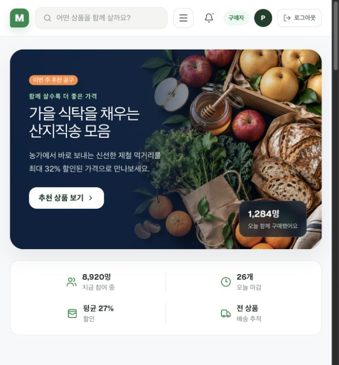
</p>

### 역할별 주요 기능

| 구매자 | 판매자 | 관리자 |
| --- | --- | --- |
| 공동구매·한정판매 조회 및 찜 | 상품·주문 현황 관리 | 판매자 입점 검토 |
| FIFO 대기열 참여와 순번 확인 | 라이브 방송 일정 신청 | 방송 승인·반려 및 사유 관리 |
| 배송 정보 입력 및 결제 | OBS 송출 정보·방송 상태 관리 | 거래·회원·신고 현황 확인 |
| 라이브 시청·실시간 채팅 | 배송·정산 현황 확인 | 서비스 운영 지표 확인 |
| 소셜 로그인·배송 조회 | 참여 신청자와 구매 현황 확인 |  |

## 핵심 문제와 해결 결과

라이브커머스 한정판매에서는 짧은 시간에 구매 요청이 집중됩니다. 단순히 결제 완료 순으로 판매하면 네트워크와 결제 속도가 빠른 사용자에게 유리하고, 여러 사용자가 결제를 진행한 뒤 품절을 경험할 수 있습니다.

여기모여는 **구매 요청이 서버에 도착한 시점에 순서를 확정**하고, 순번이 된 사용자에게만 재고를 임시 예약합니다. 재고 확인과 갱신은 DB 트랜잭션과 잠금으로 직렬화하고, 결제 승인 이후에도 서버가 예약 상태와 금액을 다시 검증합니다.

| 문제 | 해결 방법 | 검증 결과 |
| --- | --- | --- |
| 동시 요청 시 초과 판매 | 상품 재고 행에 `PESSIMISTIC_WRITE` 적용 | 1,000건 동시 요청에서 초과 판매 0건 |
| 결제 속도에 따른 불공정 | 서버 도착 순서 기반 FIFO 티켓 발급 | 예약 순서 역전 0건 |
| 결제 중 재고 소진 | 순번 사용자에게 5분간 재고 임시 예약 | 미결제·취소 시 다음 순번으로 자동 이전 |
| 더블 클릭·재전송 | `requestKey` 기반 멱등 처리 | 동일 키 50건 동시 요청에서 티켓 1건 생성 |
| 매크로·반복 요청 | Redis Lua Script 기반 사용자·IP 속도 제한 | 동일 사용자 100건 중 3건, 동일 IP 100건 중 20건 허용 |
| 반복적인 미결제 선점 | 만료 횟수 기반 단계별 참여 제한 | 24시간 내 3회 만료 시 30분, 5회 만료 시 24시간 차단 |

## 구매 처리 흐름

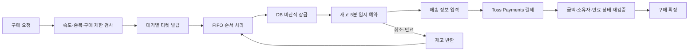

### 상태 전이

```text
WAITING → PROCESSING → RESERVED → CONFIRMED
                         ├──────→ CANCELLED
                         └──────→ EXPIRED → 다음 순번 처리

WAITING → SOLD_OUT
```

## 성능·동시성 테스트 결과

H2 기반 테스트는 모두 통과했지만, 실제 MySQL에서 1,000건의 동시 요청을 실행하자 잠금 순서 차이와 `REPEATABLE READ`의 스냅샷 읽기로 인해 데드락과 1인 요청 제한 우회가 발생했습니다.

중복 확인을 재고 잠금 이후로 이동하고 트랜잭션 격리 수준을 `READ COMMITTED`로 조정했습니다. 또한 상품 단위로 트랜잭션을 정리하고 인덱스를 추가해 잠금 범위를 축소했습니다.

### 개선 전후

| 항목 | 개선 전 | 개선 후 |
| --- | ---: | ---: |
| 1,000건 동시 구매 요청 실패 | 데드락 119건 | 0건 |
| 동일 회원 50건 동시 요청 | 1인 요청 제한 우회 | 티켓 1건만 발급 |
| 처리량 | 140 req/s | 234 req/s |
| 응답 시간 p50 / p95 | 3,738 ms / 6,426 ms | 2,528 ms / 4,063 ms |
| 동일 `requestKey` 50건 동시 요청 | 티켓 1건·오류 49건 | 티켓 1건·오류 0건 |
| 재고 초과 점유 / FIFO 순서 역전 | 0회 / 0건 | 0회 / 0건 |

<details>
<summary><b>문제의 원인과 수정 내용</b></summary>

| 문제 | 원인 | 수정 |
| --- | --- | --- |
| 데드락 119건 | 스케줄러와 구매 요청의 잠금 순서가 달랐고, 인덱스가 없어 `FOR UPDATE`의 범위 잠금이 신규 티켓 `INSERT`와 충돌 | 격리 수준을 `READ COMMITTED`로 조정하고 스케줄러를 상품 단위 트랜잭션으로 분리, 조회 인덱스 추가 |
| 1인 요청 제한 우회 | `REPEATABLE READ`의 스냅샷 읽기로 인해 잠금 대기 중 다른 요청이 생성한 티켓을 확인하지 못함 | 중복·1인 한도 확인을 재고 잠금 이후로 이동하고 최신 커밋 데이터 조회 |
| 중복 요청 오류 49건 | 중복 키 오류가 발생한 Hibernate 세션에서 다시 조회하면서 `AssertionFailure` 발생 | `requestKey` 확인을 잠금 이후로 이동해 중복 `INSERT` 자체를 방지 |

</details>

### 최종 검증 시나리오

| 시나리오 | 결과 |
| --- | --- |
| 재고 100개 상품에 1,000명이 동시에 요청하고 스케줄러 4개가 병렬 처리 | 100건만 예약·구매 확정, 900건 품절 처리 |
| 동일 `requestKey`로 50건 동시 요청 | 모든 요청에 같은 티켓을 반환하고 실제 티켓은 1건만 생성 |
| 동일 회원이 서로 다른 `requestKey`로 50건 동시 요청 | 활성 티켓 1건만 생성 |
| 재고 5개·대기자 10명 상황에서 최초 예약 5건 만료 | 다음 순번 5명에게 예약 이전, 미결제 기록 반영 |
| 동일 사용자와 동일 IP에서 각각 100건 동시 요청 | 사용자 3건·IP 20건만 허용 |

테스트는 Java Virtual Thread로 동시 클라이언트를 구성하고 실제 MySQL·Redis 환경에서 수행했습니다. 실행 결과는 `target/loadtest-report.txt`에도 기록됩니다.

### 테스트 구성

| 테스트 | 검증 내용 |
| --- | --- |
| `PurchaseQueueLoadTest` | 실제 MySQL에서 1,000건 동시 요청, 중복·매크로 요청, 미결제 만료 인계, Redis 요청 제한 |
| `PurchaseQueueConcurrencyTest` | 재고 5개에 요청 20건과 대기열 처리 80회를 동시에 실행해 한정 수량만 확정되는지 검증 |
| `GroupBuyConcurrencyTest` | 100명이 동시에 참여해도 공동구매 목표 수량 10을 넘지 않는지 검증 |
| `MemberServiceTest` | 회원 가입과 인증 관련 서비스 로직 검증 |
| `HealthControllerTest` | 백엔드 상태 확인 API 검증 |

```bash
cd backend
./mvnw test
./mvnw test -Dtest=PurchaseQueueLoadTest -Dloadtest=true
cat target/loadtest-report.txt
```

부하 테스트는 별도의 `live_group_buy_loadtest` 데이터베이스를 사용하므로 기존 서비스 데이터에 영향을 주지 않습니다.

## 시스템 구성도

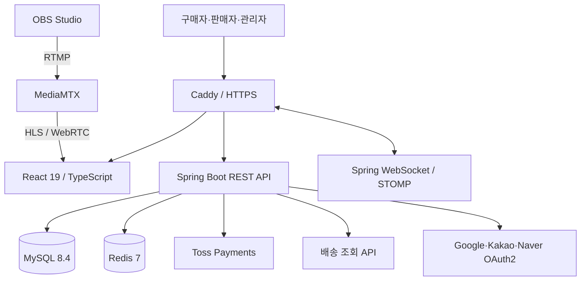

## 대표 화면

### FIFO 구매 대기열

구매 요청마다 티켓을 발급하고 현재 순번, 앞선 대기 수, 남은 재고와 추가 구매 가능 수량을 실시간으로 안내합니다.

<p align="center">
  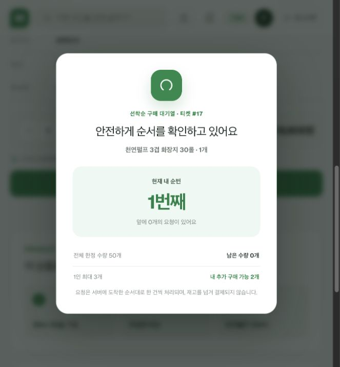
</p>

### 재고 예약과 결제

순번이 되면 재고를 5분간 확보합니다. 배송지를 입력하고 Toss Payments로 결제하면 서버가 결제 금액과 예약 상태를 다시 확인한 뒤 구매를 확정합니다.

<table width="100%">
  <tr>
    <td align="center" width="50%">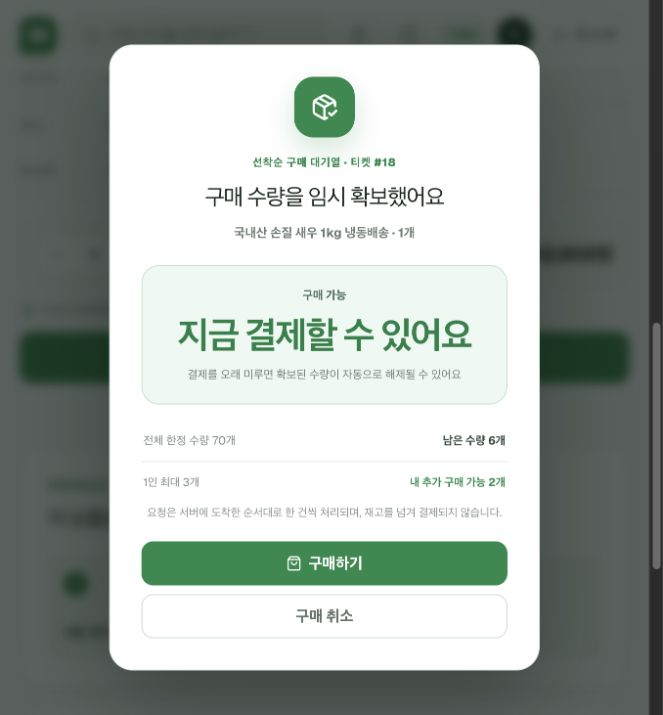</td>
    <td align="center" width="50%">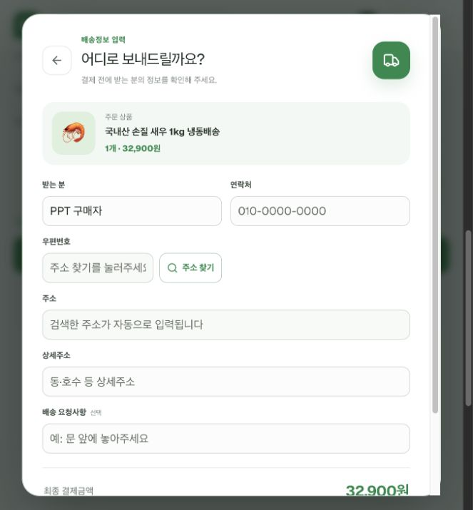</td>
  </tr>
  <tr>
    <td align="center"><b>재고 임시 예약</b></td>
    <td align="center"><b>배송 정보 입력 및 결제</b></td>
  </tr>
</table>

### 라이브커머스

구매자는 라이브 방송을 시청하며 WebSocket 채팅으로 판매자와 소통합니다. 판매자는 관리자에게 방송 일정을 신청하고, 승인된 스트림 정보를 OBS에 연결해 송출합니다.

<p align="center">
  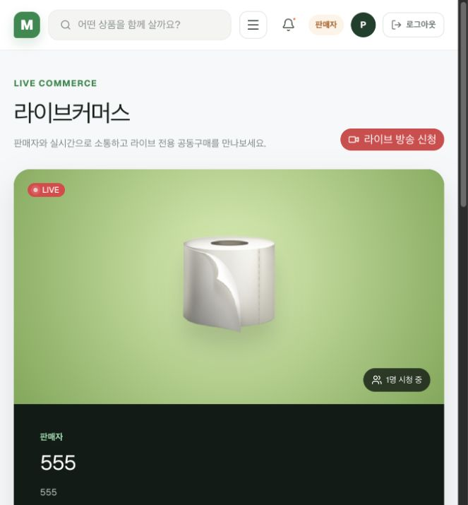
</p>

<details>
<summary><b>판매자·관리자 및 추가 화면 보기</b></summary>

### 판매자센터

<p align="center">
  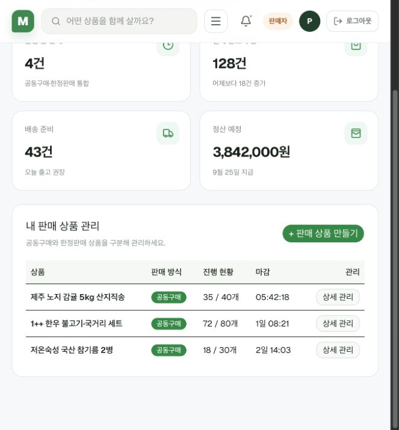
</p>

### 관리자센터와 방송 승인

<table width="100%">
  <tr>
    <td align="center" width="50%">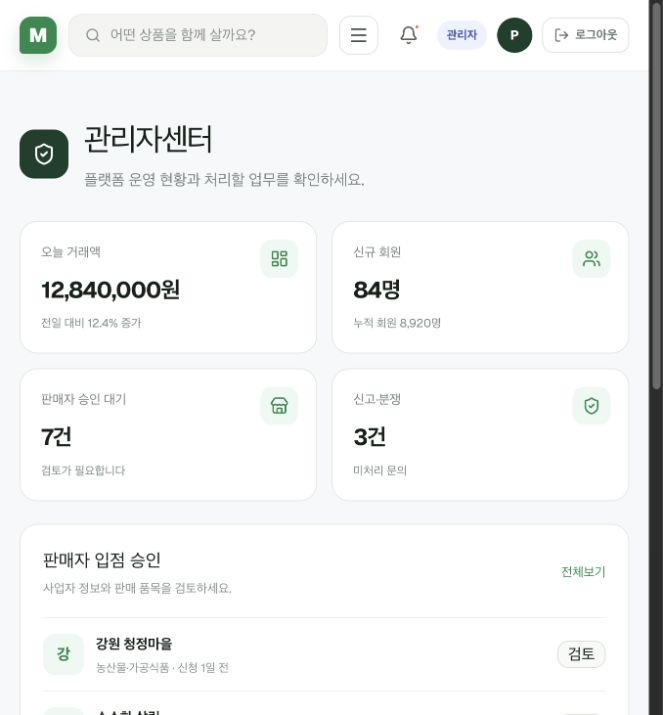</td>
    <td align="center" width="50%">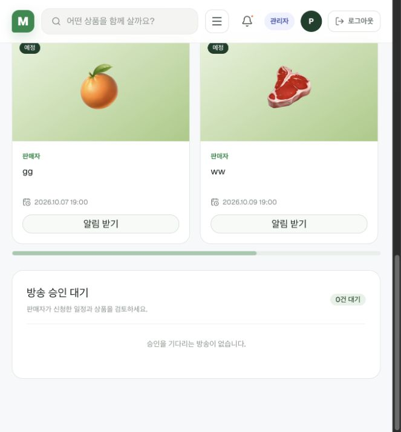</td>
  </tr>
  <tr>
    <td align="center"><b>서비스 운영 현황</b></td>
    <td align="center"><b>라이브 방송 승인·반려</b></td>
  </tr>
</table>

### 상품 상세와 반복 요청 제한

<table width="100%">
  <tr>
    <td align="center" width="50%">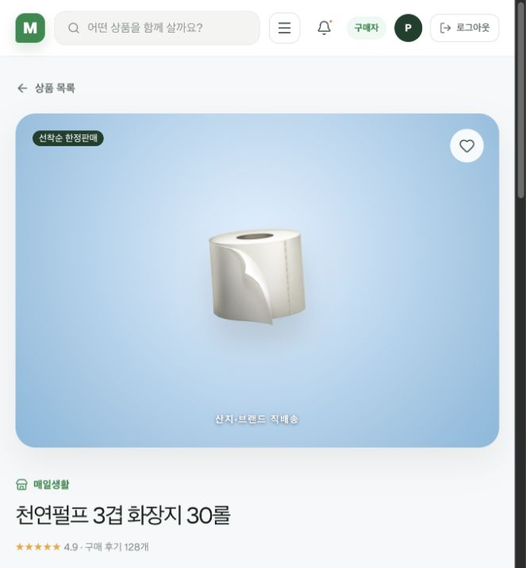</td>
    <td align="center" width="50%">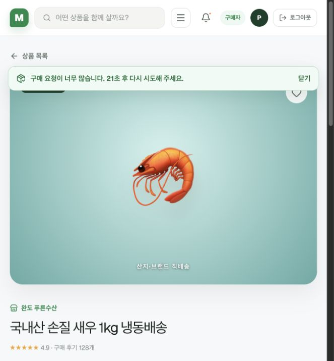</td>
  </tr>
  <tr>
    <td align="center"><b>한정판매 상품 상세</b></td>
    <td align="center"><b>Redis 기반 반복 요청 제한</b></td>
  </tr>
</table>

</details>

## 기술 스택

| 영역 | 기술 |
| --- | --- |
| Backend | Java 25, Spring Boot 4.1.0, Spring Security 7.1.0, Spring Data JPA 4.1.0, Spring WebSocket 7.0.8, OAuth2 Client, Bean Validation, Maven |
| Frontend | React 19.2.6, TypeScript 5.9.3, Vite 8.0.13, Vinext 1.0.0-beta.5, Tailwind CSS 4.2.1, shadcn UI, Base UI |
| Database | MySQL 8.4, Redis 7 |
| Live Streaming | MediaMTX 1, OBS Studio, RTMP, HLS, WebRTC |
| Infrastructure | AWS EC2, Docker Compose, Caddy 2 |
| External API | Toss Payments, Google·Kakao·Naver OAuth2, 주소 검색 API, 배송 조회 API |
| Test | JUnit 5, AssertJ, H2, MySQL·Redis 통합 부하 테스트 |

## 실행 방법·환경변수·프로젝트 구조

<details>
<summary><b>로컬 실행 방법</b></summary>

### 요구 사항

- Java 25
- Node.js 22.13 이상
- MySQL 8.4
- Docker 및 Docker Compose

### 1. MySQL 데이터베이스 생성

```sql
CREATE DATABASE live_group_buy
    CHARACTER SET utf8mb4
    COLLATE utf8mb4_unicode_ci;
```

### 2. Redis 실행

```bash
docker compose up -d redis
```

### 3. 백엔드 실행

```bash
cd backend
cp .env.properties.example .env.properties
./mvnw spring-boot:run
```

백엔드 상태 확인: `http://localhost:8080/api/health`

### 4. 프론트엔드 실행

프로젝트 루트에서 실행합니다.

```bash
cp .env.example .env.local
npm install
npm run dev
```

프론트엔드: `http://localhost:3000`

### 5. 라이브 미디어 서버 실행

```bash
docker run --rm --name mediamtx \
  -p 1935:1935 \
  -p 8888:8888 \
  -p 8889:8889 \
  -p 8189:8189/udp \
  bluenviron/mediamtx:1
```

OBS 서버 주소는 `rtmp://localhost:1935`이며 스트림 키는 판매자 방송 관리 화면에서 확인합니다.

</details>

<details>
<summary><b>프로덕션 실행 방법</b></summary>

```bash
cp .env.production.example .env.production
docker compose --env-file .env.production -f docker-compose.prod.yml --profile live up -d --build
```

`.env.production`의 `PUBLIC_HOST`와 DB 비밀번호, 외부 연동 키를 실제 값으로 변경해야 합니다. 비밀 키가 포함된 환경변수 파일은 Git에 커밋하지 않습니다.

</details>

<details>
<summary><b>환경변수</b></summary>

### Frontend

| 변수 | 설명 |
| --- | --- |
| `NEXT_PUBLIC_API_URL` | 백엔드 API 주소 |
| `NEXT_PUBLIC_RTMP_URL` | OBS 송출 서버 주소 |
| `NEXT_PUBLIC_HLS_URL` | 라이브 HLS 재생 주소 |
| `NEXT_PUBLIC_WS_URL` | 실시간 통신 WebSocket 주소 |
| `NEXT_PUBLIC_TOSS_CLIENT_KEY` | Toss Payments 클라이언트 키 |

### Backend

| 변수 | 설명 |
| --- | --- |
| `DB_URL`, `DB_USERNAME`, `DB_PASSWORD` | MySQL 접속 정보 |
| `REDIS_HOST`, `REDIS_PORT` | Redis 접속 정보 |
| `TOSS_SECRET_KEY` | Toss Payments 시크릿 키 |
| `SWEET_TRACKER_API_KEY` | 배송 조회 API 키 |
| `GOOGLE_CLIENT_ID`, `GOOGLE_CLIENT_SECRET` | Google OAuth2 설정 |
| `KAKAO_CLIENT_ID`, `KAKAO_CLIENT_SECRET` | Kakao OAuth2 설정 |
| `NAVER_CLIENT_ID`, `NAVER_CLIENT_SECRET` | Naver OAuth2 설정 |

</details>

<details>
<summary><b>프로젝트 구조</b></summary>

```text
group-buy-platform/
├── app/                    # React 화면과 상태 관리
├── components/             # 공통 UI 컴포넌트
├── docs/images/            # README 주요 화면
├── backend/
│   └── src/main/java/com/livegroupbuy/backend/
│       ├── purchase/       # FIFO 대기열, 재고 예약, 요청 제한
│       ├── payment/        # Toss 결제 준비·승인
│       ├── groupbuy/       # 공동구매 참여 처리
│       ├── live/           # 방송 신청·승인·채팅
│       ├── member/         # 회원·프로필·소셜 로그인
│       └── delivery/       # 배송 조회
├── docker-compose.yml      # 로컬 Redis 실행 환경
└── docker-compose.prod.yml # 프로덕션 전체 실행 환경
```

</details>

## 구현하며 배운 점

- 동시성 문제는 화면에서 순서를 보여주는 것으로 해결되지 않으며, 서버의 트랜잭션과 잠금이 최종 데이터 정합성을 보장해야 합니다.
- H2에서 통과한 코드도 실제 MySQL의 격리 수준과 잠금 방식에서는 다르게 동작할 수 있으므로 운영 환경과 유사한 조건에서 다시 검증해야 합니다.
- 잠금의 강도만 높이는 것이 아니라 트랜잭션 순서와 인덱스를 함께 조정해 잠금 범위를 줄여야 정합성과 처리량을 함께 확보할 수 있습니다.
- 외부 결제 성공 응답을 그대로 신뢰하지 않고 서버에서 주문 금액, 예약 소유자와 만료 상태를 다시 검증해야 합니다.
- 요청 제한은 정상 사용자의 취소와 결제 실패, Redis 장애 같은 예외 상황을 구분하면서도 DB 잠금과 구매 수량 제한으로 재고 정합성을 유지해야 합니다.
- 기능 완성 여부를 정상 흐름만으로 판단하지 않고 중복 요청, 미결제 선점, 서버 재시작과 같은 실패 상황까지 테스트하는 습관을 갖추었습니다.
