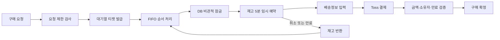
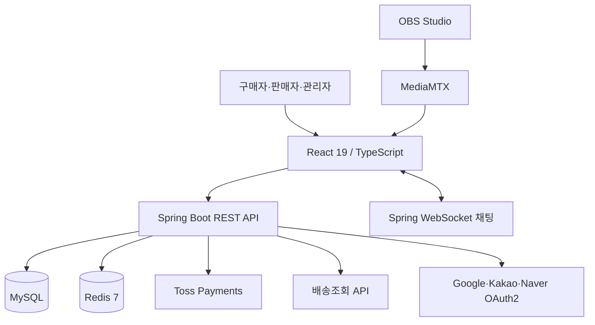

# 여기모여

> 라이브 방송을 보며 공동구매와 한정판매에 참여하고, 요청이 몰려도 **도착한 순서대로·준비된 수량만큼만** 판매되는 라이브커머스 플랫폼

## 배포 주소 · GitHub · 시연 영상

| 구분 | 주소 |
| --- | --- |
| 배포 주소 | 준비 중 |
| GitHub | https://github.com/stone-iron/group-buy |
| 시연 영상 | 준비 중 |

## 프로젝트 정보

| 구분 | 내용 |
| --- | --- |
| 개발 기간 | 2026.09.16 ~ 2026.10.06 |
| 개발 인원 | 1명 |
| 담당 범위 | 기획, UI, 프론트엔드, 백엔드, DB 설계, 외부 API 연동 |
| 핵심 주제 | 동시성 제어, 초과 판매 방지, 매크로·미결제 악용 방지 |

## 핵심 문제와 해결 결과

라이브커머스 한정판매에서는 짧은 시간에 많은 구매 요청이 들어옵니다. 결제 완료 순으로 판매하면 네트워크와 결제 속도가 빠른 사용자에게 유리하고, 여러 사용자가 결제를 진행한 뒤에야 품절을 겪을 수 있습니다. 여기모여는 구매 요청을 먼저 접수해 순서를 확정하고, 순번이 된 사용자에게만 재고를 임시로 확보합니다.

| 문제 | 해결 | 결과 |
| --- | --- | --- |
| 결제가 빠른 사용자에게 유리한 선착순 | 요청마다 티켓을 발급하고 도착 순서대로 처리하는 FIFO 대기열 | 1,000건 동시 요청에서 순서 역전 0건 |
| 동시 요청으로 인한 초과 판매 | 재고 행 비관적 잠금과 결제 전 임시 예약 | 재고 100개에 1,000명이 몰려도 초과 점유 0회 |
| 재고를 잡고 결제하지 않는 선점 | 5분 예약 만료 후 다음 순번에게 자동 인계, 반복 미결제 패널티 | 만료된 예약 5건이 다음 순번 5명에게 그대로 인계 |
| 매크로·더블 클릭 반복 요청 | Redis 속도 제한, 회원별 활성 티켓 1개, `requestKey` 멱등 처리 | 같은 회원 동시 50회 요청 → 티켓 1건 |
| 클라이언트가 보낸 결제 결과 조작 | Toss 승인 후 서버에서 금액·소유자·예약 만료를 다시 검증 | 검증을 통과한 예약만 구매 확정 |
| **실제 MySQL에서만 드러난 데드락과 제한 우회** | 격리 수준 READ COMMITTED, 잠금 이후 중복 확인, 상품 단위 트랜잭션, 인덱스 | 요청 실패 119건 → **0건**, 처리량 140 → **234 req/s** |

## 구매 처리 흐름



### FIFO 구매 대기열

- 구매 요청마다 티켓을 발급하고 티켓 번호 순서대로 처리합니다.
- `WAITING → PROCESSING → RESERVED → CONFIRMED` 상태를 구분해 관리합니다.
- 구매자에게 현재 순번, 앞선 요청 수, 남은 수량을 표시합니다.
- 결제 속도가 아니라 구매 요청이 서버에 도착한 순서로 기회를 제공합니다.

### 동시성 및 초과 판매 방지

- JPA `PESSIMISTIC_WRITE` 비관적 잠금으로 같은 재고의 동시 갱신을 막습니다.
- 재고를 바꾸는 트랜잭션은 `READ COMMITTED`로 실행해, 잠금을 얻은 뒤에는 다른 요청이 커밋한 최신 데이터를 읽습니다.
- 중복 요청과 1인 한도 확인은 재고 잠금을 얻은 **뒤에** 합니다. 같은 상품의 요청은 잠금 앞에서 줄을 서므로 뒤 요청은 앞 요청이 만든 티켓을 확인할 수 있습니다.
- 대기열 처리 스케줄러는 상품마다 별도 트랜잭션으로 실행해 한 번에 하나의 재고 잠금만 보유합니다.
- 예약 만료 또는 구매 취소 시 다음 순번에게 재고를 자동으로 넘깁니다.
- Toss Payments 승인 후 서버가 주문 금액과 예약 상태를 다시 검증한 뒤 구매를 확정합니다.

### 매크로 및 악용 방지

| 안전장치 | 정책 |
| --- | --- |
| 사용자 요청 제한 | 사용자당 초당 3회 |
| IP 요청 제한 | IP당 초당 20회 |
| 구매 수량 제한 | 상품별 1인 최대 수량 적용 |
| 중복 요청 방지 | 활성 티켓 검사 및 `requestKey` 기반 멱등 처리 |
| 미결제 패널티 | 24시간 내 3회 만료 시 30분, 5회 만료 시 24시간 참여 제한 |
| Redis 장애 대응 | Fail-open 후 DB 락과 수량 제한으로 재고 정합성 유지 |

요청 제한은 Redis Lua Script로 카운트 증가와 만료 시간 설정을 원자적으로 처리합니다. 사용자가 직접 취소한 요청과 결제 실패는 미결제 패널티에 포함하지 않습니다.

## 성능·동시성 테스트 결과

### MySQL 부하 테스트 (`PurchaseQueueLoadTest`)

H2 기반 동시성 테스트는 모두 통과했지만, 실제 MySQL에서 같은 흐름을 다시 검증하자 H2에서는 드러나지 않던 문제가 발견되었습니다. 테스트는 로컬 MySQL에서 1,000건의 구매 요청을 동시에 출발시키는 동안 대기열 스케줄러 4개를 함께 실행하고, 이어서 예약자 100명의 결제를 동시에 확정했습니다.

| 항목 | 수정 전 | 수정 후 |
| --- | --- | --- |
| 동시 요청 1,000건 중 실패 | **119건** (데드락) | **0건** |
| 처리량 | 140 req/s | **234 req/s** |
| 응답 시간 p50 / p95 | 3,738 ms / 6,426 ms | **2,528 ms / 4,063 ms** |
| 재고 100개 초과 점유 · 순서 역전 | 0회 · 0건 | 0회 · 0건 |
| 같은 회원이 다른 `requestKey`로 동시 50회 요청 | 티켓 **50건** (1인 제한 우회) | 티켓 **1건** |
| 같은 `requestKey`로 동시 50회 요청 | 티켓 1건, 오류 **49건** | 티켓 1건, 오류 **0건** |
| 예약자 100명 동시 결제 | - | 실패 0건, 판매 100개, 남은 예약 0개 |
| 미결제 만료 후 다음 순번 인계 | 5명 → 5명 | 5명 → 5명 |

<details>
<summary><b>원인과 수정 내용</b></summary>

| 문제 | 원인 | 수정 |
| --- | --- | --- |
| 데드락 119건 | 스케줄러는 만료 티켓 → 재고, 구매 요청은 재고 → 새 티켓 순으로 잠갔고, 인덱스가 없어 `FOR UPDATE`가 테이블 전체에 범위 잠금(gap lock)을 걸어 INSERT를 막음 | `READ COMMITTED`로 범위 잠금 제거, 스케줄러를 상품 단위 트랜잭션으로 분리, 조회용 인덱스 3개 추가 |
| 1인 제한 우회 | `REPEATABLE READ`에서는 트랜잭션의 첫 조회 시점 스냅샷을 계속 읽어, 재고 잠금을 기다리는 동안 다른 요청이 만든 티켓을 보지 못함 | 구매 요청 트랜잭션을 `READ COMMITTED`로 실행 |
| 중복 요청 오류 49건 | 중복 키 오류가 난 Hibernate 세션으로 다시 조회하면서 `AssertionFailure` 발생 | `requestKey` 확인을 재고 잠금 이후로 옮겨 중복 INSERT 자체를 방지 |

</details>

### Redis 요청 제한

`PurchaseRateLimitService`의 Lua Script를 Redis 7에서 그대로 실행해 측정했습니다.

| 상황 | 허용 | 차단 |
| --- | --- | --- |
| 같은 회원이 동시에 100회 요청 (초당 3회 제한) | 3 | 97 |
| 같은 IP에서 동시에 500회 요청 (초당 20회 제한) | 20 | 480 |
| 같은 회원이 5초 동안 초당 약 50회 연속 요청 | 15 | 229 |

### 테스트 목록

| 테스트 | 검증 내용 |
| --- | --- |
| `PurchaseQueueLoadTest` | 실제 MySQL에서 1,000건 동시 요청, 중복·매크로 요청, 미결제 만료 인계, Redis 요청 제한 |
| `PurchaseQueueConcurrencyTest` | 재고 5개에 요청 20건과 대기열 처리 80회를 동시 실행해 한정 수량만 확정되는지 검증 (H2) |
| `GroupBuyConcurrencyTest` | 100명이 동시에 참여해도 공동구매 목표 수량 10을 넘지 않는지 검증 |
| `MemberServiceTest` | 회원 가입과 인증 관련 서비스 로직 검증 |
| `HealthControllerTest` | 백엔드 상태 확인 API 검증 |

```bash
cd backend
./mvnw test                                              # 기본 테스트 (H2)
./mvnw test -Dtest=PurchaseQueueLoadTest -Dloadtest=true  # MySQL 부하 테스트 (MySQL·Redis 실행 필요)
cat target/loadtest-report.txt                           # 부하 테스트 결과 요약
```

부하 테스트는 `live_group_buy_loadtest` 데이터베이스를 자동으로 만들어 사용하므로 기존 데이터에 영향을 주지 않습니다.

## 시스템 구성도



## 주요 기능 및 대표 화면

| 역할 | 기능 |
| --- | --- |
| 구매자 | 상품 조회·찜, 구매 대기열과 실시간 순번 확인, Toss 결제, 라이브 시청·채팅, 방송 알림, 배송 조회, 소셜 로그인 |
| 판매자 | 공동구매·한정판매 상품과 주문 관리, 방송 일정 신청, OBS 송출 정보 확인, 배송·정산 현황 |
| 관리자 | 판매자 입점 검토, 방송 승인·반려와 반려 사유 관리, 거래·회원·신고 현황 확인 |

### 메인 화면

<table width="100%">
  <tr>
    <th width="420">화면</th>
    <th>기능 설명</th>
  </tr>
  <tr>
    <td align="center" width="420"></td>
    <td><details><summary><b>메인 화면</b></summary><br>추천 기획전 배너와 함께 지금 참여 중인 인원, 오늘 마감되는 공동구매, 평균 할인율, 배송 현황을 한눈에 보여줍니다.</details></td>
  </tr>
</table>

### 한정판매 구매 흐름

<table width="100%">
  <tr>
    <th width="420">화면</th>
    <th>기능 설명</th>
  </tr>
  <tr>
    <td align="center" width="420"></td>
    <td><details><summary><b>한정판매 상세</b></summary><br>선착순 한정판매 상품의 정보와 평점, 후기를 확인하고 찜하거나 구매 대기열에 참여합니다.</details></td>
  </tr>
  <tr>
    <td align="center" width="420"></td>
    <td><details><summary><b>FIFO 구매 대기열</b></summary><br>구매 요청마다 티켓을 발급하고 현재 순번, 앞선 대기 수, 남은 수량, 1인 추가 구매 가능 수량을 실시간으로 보여줍니다.</details></td>
  </tr>
  <tr>
    <td align="center" width="420"></td>
    <td><details><summary><b>재고 임시 확보</b></summary><br>순번이 되면 구매 수량을 5분간 확보합니다. 시간 안에 결제하지 않거나 취소하면 다음 순번에게 자동으로 넘어갑니다.</details></td>
  </tr>
  <tr>
    <td align="center" width="420"></td>
    <td><details><summary><b>배송정보 입력과 결제</b></summary><br>주소 검색으로 배송지를 입력하고 결제 금액을 확인한 뒤 Toss Payments로 결제합니다. 서버가 금액과 예약 상태를 다시 검증한 뒤 구매를 확정합니다.</details></td>
  </tr>
  <tr>
    <td align="center" width="420"></td>
    <td><details><summary><b>반복 요청 제한</b></summary><br>짧은 시간에 구매 요청을 반복하면 Redis 기반 속도 제한으로 차단하고, 다시 시도할 수 있는 시간을 안내합니다.</details></td>
  </tr>
</table>

### 라이브커머스와 운영 화면

<table width="100%">
  <tr>
    <th width="420">화면</th>
    <th>기능 설명</th>
  </tr>
  <tr>
    <td align="center" width="420"></td>
    <td><details><summary><b>라이브커머스</b></summary><br>진행 중인 라이브 방송과 시청자 수를 확인하고, 방송을 보며 실시간 채팅으로 판매자와 소통합니다. 판매자는 이 화면에서 라이브 방송을 신청합니다.</details></td>
  </tr>
  <tr>
    <td align="center" width="420"></td>
    <td><details><summary><b>판매자센터</b></summary><br>공동구매와 한정판매 상품의 진행 현황과 마감 시간을 관리하고, 배송 준비 건수와 정산 예정 금액을 확인합니다.</details></td>
  </tr>
  <tr>
    <td align="center" width="420"></td>
    <td><details><summary><b>관리자센터</b></summary><br>오늘 거래액, 신규 회원, 판매자 승인 대기, 신고 현황을 확인하고 판매자 입점 신청을 검토합니다.</details></td>
  </tr>
  <tr>
    <td align="center" width="420"></td>
    <td><details><summary><b>방송 승인 관리</b></summary><br>판매자가 신청한 방송 일정과 상품을 검토해 승인하거나 반려합니다.</details></td>
  </tr>
</table>

## 기술 스택

| 구분 | 기술 |
| --- | --- |
| Backend | Java 25, Spring Boot 4.1, Spring Data JPA, Spring Security, OAuth2 Client, Spring WebSocket, Bean Validation, Maven |
| Frontend | React 19, TypeScript 5, Vite 8, Vinext, Tailwind CSS 4, shadcn UI, Base UI |
| Data · Infra | MySQL, Redis 7, Docker, MediaMTX, OBS Studio |
| External API | Toss Payments, Google·Kakao·Naver OAuth2, 주소 검색 API, 배송 조회 API |
| Test | JUnit 5, Spring Boot Test, H2 (단위·동시성), MySQL (부하 테스트) |

## 실행 방법 · 환경변수 · 프로젝트 구조

### 1. MySQL 데이터베이스 생성

```sql
CREATE DATABASE live_group_buy
    CHARACTER SET utf8mb4
    COLLATE utf8mb4_unicode_ci;
```

### 2. Redis 실행

```bash
docker compose up -d redis
```

### 3. 백엔드 실행

```bash
cd backend
cp .env.properties.example .env.properties
./mvnw spring-boot:run
```

백엔드 상태 확인: `http://localhost:8080/api/health`

### 4. 프론트엔드 실행

```bash
cp .env.example .env.local
npm install
npm run dev
```

프론트엔드: `http://localhost:3000`

### 5. 라이브 미디어 서버 실행

```bash
docker run --rm --name mediamtx \
  -p 1935:1935 \
  -p 8888:8888 \
  -p 8889:8889 \
  -p 8189:8189/udp \
  bluenviron/mediamtx:1
```

OBS의 서버 주소는 `rtmp://localhost:1935`이며 스트림 키는 판매자 방송 관리 화면에서 확인합니다.

### 환경변수

실제 키는 Git에 커밋하지 않고 예시 파일을 복사해 로컬에서 설정합니다.

| 위치 | 변수 | 설명 |
| --- | --- | --- |
| Frontend | `NEXT_PUBLIC_API_URL` | 백엔드 API 주소 |
| Frontend | `NEXT_PUBLIC_TOSS_CLIENT_KEY` | Toss Payments 클라이언트 키 |
| Backend | `spring.datasource.password` | MySQL 비밀번호 |
| Backend | `payment.toss.secret-key` | Toss Payments 시크릿 키 |
| Backend | `delivery.tracking.api-key` | 배송 조회 API 키 |
| Backend | OAuth Client ID·Secret | Google·Kakao·Naver 로그인 설정 |

### 프로젝트 구조

```text
group-buy-platform/
├── app/                    # React 화면과 상태 관리
├── components/             # 공통 UI 컴포넌트
├── docs/images/            # README 주요 화면
├── backend/
│   └── src/
│       ├── main/java/com/livegroupbuy/backend/
│       │   ├── purchase/   # FIFO 대기열, 재고 예약, 요청 제한
│       │   ├── payment/    # Toss 결제 준비·승인
│       │   ├── groupbuy/   # 공동구매 참여 처리
│       │   ├── live/       # 방송 신청·승인·채팅
│       │   ├── member/     # 회원·프로필·소셜 로그인
│       │   └── delivery/   # 배송 조회
│       └── test/           # 동시성·부하 테스트
└── docker-compose.yml      # Redis 실행 환경
```

## 구현하며 배운 점

- 동시성 문제는 화면에서 순서를 표시하는 것만으로 해결되지 않으며, DB 트랜잭션과 잠금이 최종 정합성을 보장해야 합니다.
- 잠금을 거는 것만으로는 충분하지 않습니다. `REPEATABLE READ`에서는 잠금을 얻은 뒤에도 오래된 스냅샷을 읽을 수 있어, 격리 수준과 잠금 순서, 잠금 범위를 함께 설계해야 합니다.
- H2에서 통과한 테스트도 실제 MySQL의 격리 수준과 잠금 방식에서는 다르게 동작할 수 있어, 운영과 같은 DB에서 부하 테스트로 다시 검증해야 합니다.
- 외부 결제 성공 응답만 신뢰하지 않고 서버의 주문 금액, 예약 소유자, 만료 여부를 다시 검증해야 합니다.
- 요청 제한은 강하게 차단하는 것뿐 아니라 Redis 장애나 정상 사용자의 취소처럼 예외 상황을 구분하는 정책이 중요합니다.
